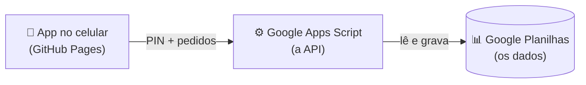

# 🛠️ Como montar a sua própria versão

Este é o guia **técnico** do projeto: como funciona por dentro, como instalar e o que fazer quando algo não funciona.
Para conhecer o app, volte ao [README](README.md).

---

## 🧩 Como funciona

Não há servidor para manter. O app é um site estático que conversa com um script do Google ligado à sua própria planilha.



- **Front-end** (`index.html`): a interface, hospedada no GitHub Pages.
- **Back-end** (`Code.gs`): um Google Apps Script publicado como aplicativo da web. Ele confere o PIN, lê e grava na planilha.
- **Banco de dados:** a planilha do Google, na sua conta.

Todo dia, perto da meia-noite, um gatilho cria as doses do dia novo, todas desmarcadas. Nada é apagado: o histórico dos dias anteriores fica guardado na planilha.

---

## 📊 A planilha

As abas são criadas pelo script. Você pode preencher e corrigir direto nelas, se quiser.

<details>
<summary><b>💊 Medicamentos</b> (uma linha por remédio)</summary>

| Coluna | Conteúdo |
|---|---|
| A | ID (criado automaticamente) |
| B | Nome comercial |
| C | Princípio ativo |
| D | Outros nomes |
| E | Dosagem |
| F | Forma |
| G | Posologia |
| H | Horários (ex.: `08:00, 14:00, 20:00`) |
| I | Para que serve |
| J a L | Médico prescritor, início do uso, fim previsto |
| M | Estoque atual |
| N | Validade |
| O | Observações |
| P | Status (`Ativo` ou `Suspenso`) |
| Q | Tratamento (`Sim` ou vazio) |
| R a U | Por dose, unidade de uso, quantidade por embalagem, dias de antecedência para comprar |

Para aparecer em **Hoje**, o remédio precisa de **nome**, **horários** e **status Ativo**.

</details>

<details>
<summary><b>✅ Registro de doses</b> (preenchida pelo app)</summary>

Data, horário, ID, medicamento, dosagem, "tomou?", hora em que foi marcado e se é do tratamento.

</details>

<details>
<summary><b>❤️ Pressão</b></summary>

Data, hora, sistólica, diastólica e pulso.

</details>

<details>
<summary><b>📦 Itens</b></summary>

ID, item, categoria, quantidade, unidade, mínimo e observações.

</details>

<details>
<summary><b>📅 Agenda</b></summary>

ID, data, "até" (para períodos), hora, tipo (Sessão, Remédio ou Outro), título, medicamento, observações, dias de antecedência da autorização, autorização pedida, feito, **ciclo** (número da sessão de quimioterapia) e contato (médico ou clínica).

</details>

<details>
<summary><b>📞 Contatos</b></summary>

ID, nome, tipo (médico, clínica, hospital, laboratório, farmácia ou outro), especialidade, telefone, endereço e observações.

</details>

<details>
<summary><b>📁 Documentos</b> (ficam no Google Drive, não na planilha)</summary>

Os exames e documentos enviados pelo app ficam em uma pasta chamada **Documentos - Minhas medicações**, criada no Drive ao lado da planilha. Cada arquivo guarda a categoria (exame, receita, laudo…) e só abre para quem estiver logado na sua conta Google.

</details>

---

## 🚀 Instalação passo a passo

### 1. Crie a planilha

Crie uma planilha nova no Google Planilhas. Em **Arquivo → Configurações**, confira se o fuso horário está correto, por exemplo `(GMT-03:00) Recife`.

### 2. Configure o back-end

1. Na planilha, abra **Extensões → Apps Script**.
2. Apague o código que vier de exemplo e cole o conteúdo de [`Code.gs`](Code.gs).
3. Em **Configurações do projeto**, confira o fuso horário do script.
4. Execute a função **`prepararPlanilha`** uma vez e autorize o acesso. Ela cria as abas com os cabeçalhos certos.
5. *(Opcional, deixa a planilha bonita)* Clique no **+** ao lado de "Arquivos", escolha **Script**, dê o nome `Planilha`, cole o conteúdo de [`Planilha.gs`](Planilha.gs) e execute a função **`embelezarPlanilha`**. Ela só muda a aparência (cores, fonte Nunito e cabeçalhos), nunca os dados.
6. Execute a função **`autorizarDrive`** uma vez e aceite as permissões. Ela cria a pasta de documentos no seu Google Drive.
7. Abra a função **`definirPin`**, troque o número `123456` pelo **PIN que você quer** (use 6 dígitos ou mais), execute-a uma vez e depois **apague o PIN do código**. Só o resumo criptografado (hash) fica guardado.
8. Execute a função **`criarGatilhoDiario`** uma vez.
9. Vá em **Implantar → Nova implantação → App da Web** e configure:
   - **Executar como:** Eu
   - **Quem tem acesso:** Qualquer pessoa
10. Copie a **URL** que termina em `/exec`.

> 💡 Teste: cole a URL no navegador. Se aparecer apenas **ok**, está funcionando.

### 3. Configure o front-end

Abra o `index.html` e cole a URL na linha:

```js
const API_URL = 'COLE_AQUI_A_URL_DO_APPS_SCRIPT'; // termina com /exec
```

### 4. Publique no GitHub Pages

1. Crie um repositório e envie estes arquivos, **todos na mesma pasta**:

   ```
   📁 seu-repositorio
   ├── index.html
   ├── manifest.json
   ├── sw.js
   ├── Code.gs            (opcional: cópia do back-end, só para guardar)
   ├── Planilha.gs        (opcional: cópia do código que embeleza a planilha)
   └── 📁 icons
       ├── icon-192.png
       ├── icon-512.png
       ├── apple-touch-icon.png
       ├── favicon.svg
       ├── favicon.ico
       ├── favicon-32x32.png
       └── favicon-16x16.png
   ```

2. Em **Settings → Pages**, escolha a branch `main` e a pasta raiz.
3. Em um ou dois minutos o app abre em `https://seu-usuario.github.io/seu-repositorio/`.

---

## 📱 Instalando no celular

**Android (Chrome ou Samsung Internet)**
Abra o link, toque no menu **⋮** e escolha **Instalar app**. Ele abre em tela cheia, com ícone próprio.

**iPhone (Safari)**
Abra o link no **Safari**, toque em **Compartilhar → Adicionar à Tela de Início**.

> ℹ️ O app precisa de internet para buscar os dados. Ele mostra a última versão guardada enquanto atualiza.

---

## 🔄 Atualizando o app

| Mudou... | O que fazer |
|---|---|
| **`Planilha.gs`** | Cole no arquivo `Planilha` do Apps Script e execute `embelezarPlanilha` de novo. Não precisa de nova versão da implantação. |
| **`Code.gs`** | Cole o novo código no Apps Script e faça **Implantar → Gerenciar implantações → ✏️ → Versão: Nova versão → Implantar**. Não crie uma "nova implantação", senão a URL muda. |
| **`index.html`**, **`sw.js`** ou **`manifest.json`** | Envie os arquivos para o repositório e espere um ou dois minutos. Se o celular ainda mostrar a versão antiga, feche e abra o app de novo. |

Se você editar a aba **Medicamentos** diretamente na planilha, toque em **Atualizar** no menu do app para as doses de hoje acompanharem a mudança.

---

## 🔒 Privacidade e segurança

- Os dados ficam **na sua conta Google**, na sua planilha.
- O acesso ao app é protegido por **PIN**. O PIN não fica em texto: só o hash dele é guardado no Apps Script.
- Depois de **5 tentativas erradas**, as tentativas ficam bloqueadas por 15 minutos.
- Como o app é público no GitHub, a **URL do Apps Script fica visível** no `index.html`. Sozinha ela não dá acesso aos dados, mas por isso o PIN deve ser forte.
- O celular guarda uma cópia dos dados para abrir mais rápido. O botão **Sair** apaga essa cópia e o PIN salvo.
- Se o repositório for público, **não coloque** informações pessoais no código nem em arquivos do projeto.

---

## 🩹 Solução de problemas

| Sintoma | Provável causa e solução |
|---|---|
| **"Sem conexão com o servidor…"** | Confira a internet, a `API_URL` no `index.html` e se a implantação está com acesso para **Qualquer pessoa**. Abra a URL `/exec` no navegador: deve aparecer **ok**. |
| **"O Apps Script respondeu algo inesperado…"** | A implantação não foi atualizada ou o código tem erro. Faça uma **Nova versão** e veja a aba **Execuções** do Apps Script. |
| **"Ação inválida"** | O `Code.gs` novo foi colado, mas a implantação ainda usa a versão antiga. Faça **Nova versão**. |
| **Tela em branco** | A linha `API_URL` pode estar sem aspas ou sem o `;`. |
| **Não aparece "Instalar app"** | Confira se `manifest.json`, `sw.js` e a pasta `icons/` abrem no navegador (um 404 impede a instalação). Use Chrome ou Samsung Internet no Android. No iPhone, use o Safari. |
| **Erro ao abrir ou enviar documentos** | Falta autorizar o Drive: no Apps Script, execute **`autorizarDrive`** uma vez e faça **Implantar → Gerenciar implantações → ✏️ → Nova versão → Implantar**. |
| **Um remédio não aparece em "Hoje"** | Ele precisa de nome, horários e status **Ativo**. Se tiver dias marcados na Agenda, só aparece nesses dias. Toque em **Atualizar**. |
| **Aparece "já está instalado" ao instalar** | Outro app do mesmo endereço (`seu-usuario.github.io`) pode estar instalado. Este projeto usa um `id` próprio no `manifest.json` para evitar isso. Reenvie o manifest e limpe os dados do site. |

---

## ⚠️ Limitações

- Precisa de **internet** para atualizar os dados.
- **Não envia notificações** de lembrete de dose. Os avisos aparecem dentro do app.
- Pensado para **uso pessoal ou familiar**: todos que usam o app compartilham o mesmo PIN e os mesmos dados.
- Está sujeito às cotas gratuitas do Google Apps Script.
- A previsão de estoque e a classificação da pressão são **estimativas de apoio**. Elas dependem das doses serem marcadas e **não substituem a orientação médica**.

---

## 🧰 Tecnologias

- HTML, CSS e JavaScript puros, sem bibliotecas
- Ícones [Lucide](https://lucide.dev), embutidos no código
- Fontes **Baloo 2** e **Nunito** (Google Fonts)
- PWA com *manifest* e *service worker*
- Google Apps Script e Google Planilhas
