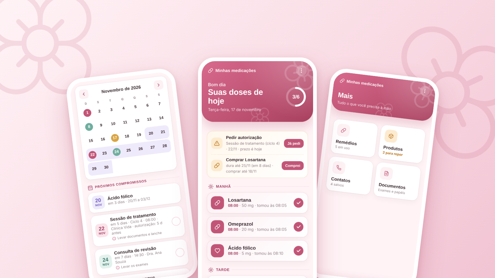
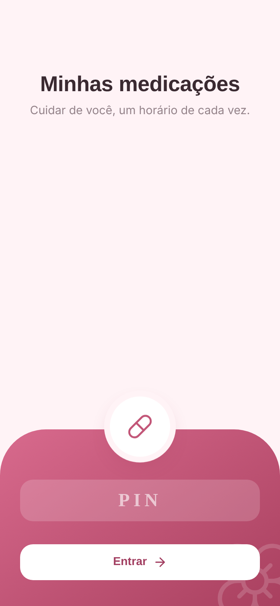
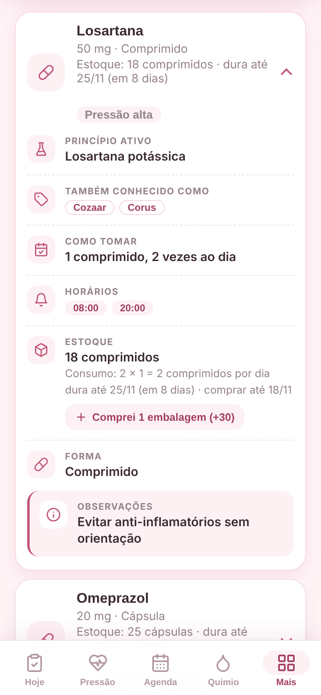
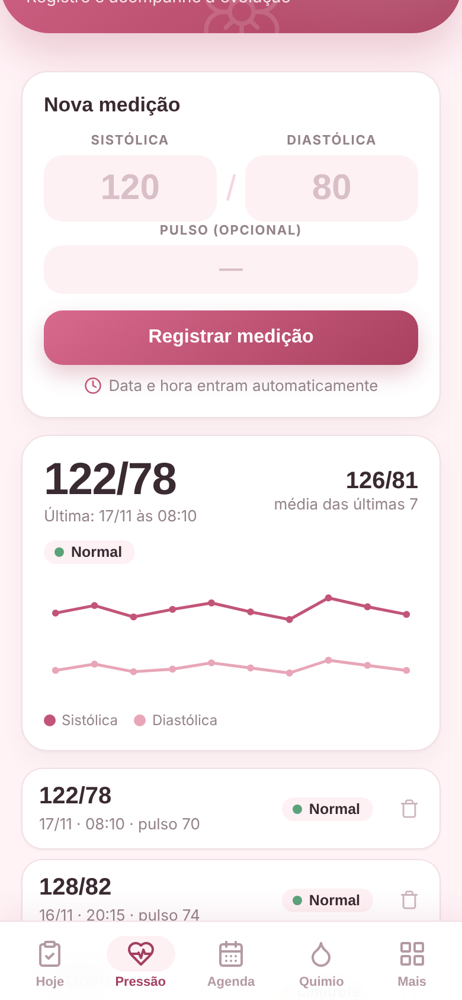
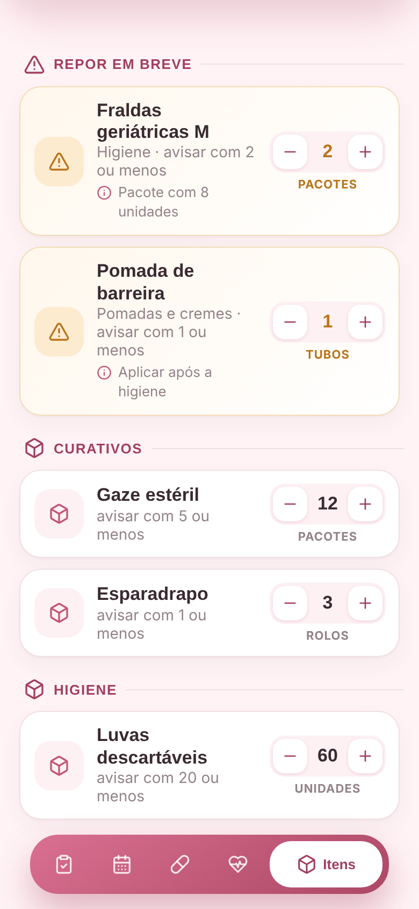

# 🌸 Minhas medicações

**Cuidar de quem a gente ama fica mais leve quando tudo está num só lugar.**

---

## 💗 Sobre o projeto

**Minhas medicações** é um aplicativo pessoal, criado para organizar o dia a dia de um tratamento de saúde: que remédio tomar e a que horas, as consultas e sessões, a pressão arterial e as coisas que não podem faltar em casa, como fraldas, gazes e pomadas.

Ele nasceu de uma necessidade real da família: são muitos horários, muitas datas para lembrar, autorizações para pedir com antecedência e remédios para comprar antes de acabarem. A ideia é simples: abrir o app, ver o que é para hoje e ficar tranquila.

---

## ✨ O que ele faz

| | |
|---|---|
| 📋 **Hoje** | Mostra as doses do dia, da manhã à noite. É só tocar para marcar o que já foi tomado e acompanhar o progresso do dia. |
| 📅 **Agenda** | Um calendário colorido com as sessões, os dias de cada remédio e as consultas, além dos **próximos compromissos** à vista. |
| 💊 **Remédios** | A ficha de cada medicamento: para que serve, outros nomes, dosagem, horários e observações. |
| ❤️ **Pressão** | Um registro rápido da pressão arterial. Basta digitar os números: a data e a hora entram sozinhas, e o app mostra a evolução em um gráfico. |
| 📦 **Itens** | O estoque de tudo o que não é remédio, com botões simples para ajustar as quantidades. |

---

## 🌷 Pequenos cuidados que fazem diferença

- **Lembra das autorizações:** avisa quando é hora de pedir a autorização de uma sessão ou de um remédio.
- **Avisa a hora de comprar:** calcula quanto tempo o estoque de cada remédio dura e lembra de comprar antes de acabar.
- **Respeita o tratamento:** os remédios do tratamento ficam destacados, e os que são tomados só em certos períodos aparecem apenas nesses dias.
- **Mais de uma dose por dia:** cada horário é marcado separadamente.
- **Visual delicado e fácil de usar:** pensado para o celular, com letras grandes e poucos toques.
- **Funciona como um app:** pode ser colocado na tela inicial do celular, em tela cheia.

---

## 📱 Um olhar por dentro

<table>
  <tr>
    <td align="center"> <b>Entrada protegida por PIN</b></td>
    <td align="center"> <b>Hoje</b></td>
    <td align="center"> <b>Agenda</b></td>
  </tr>
  <tr>
    <td align="center"> <b>Remédios</b></td>
    <td align="center"> <b>Pressão</b></td>
    <td align="center"> <b>Itens</b></td>
  </tr>
</table>

Todas as imagens usam <b>dados fictícios</b>.

---

## 🔒 Privacidade

As informações ficam guardadas na própria conta Google de quem usa o app, e o acesso é protegido por um PIN. Nada é compartilhado com ninguém.

---

## 🛠️ Feito com

Google Planilhas, Google Apps Script e GitHub Pages.

> ⚠️ Este app é um apoio de organização e **não substitui a orientação de médicos e outros profissionais de saúde**.

---

Feito com carinho 🌸

