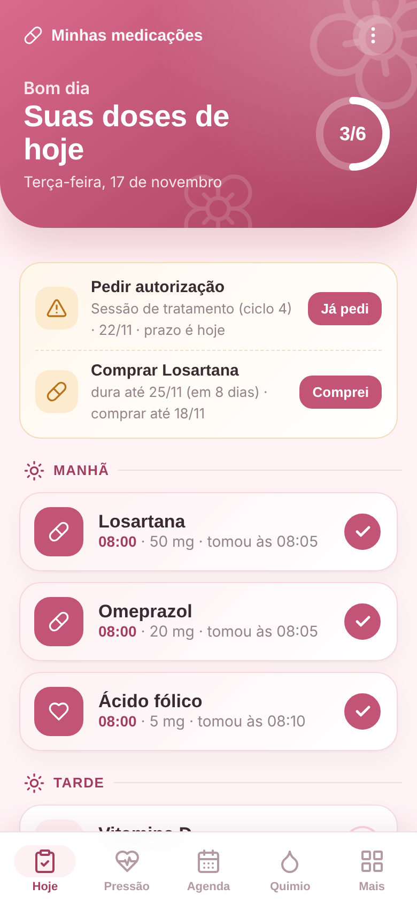
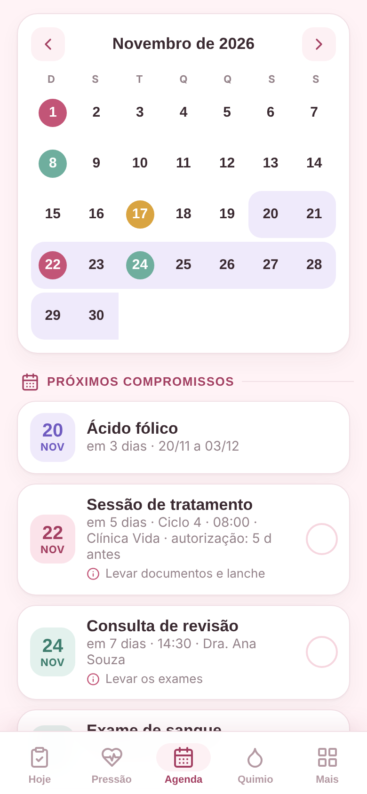
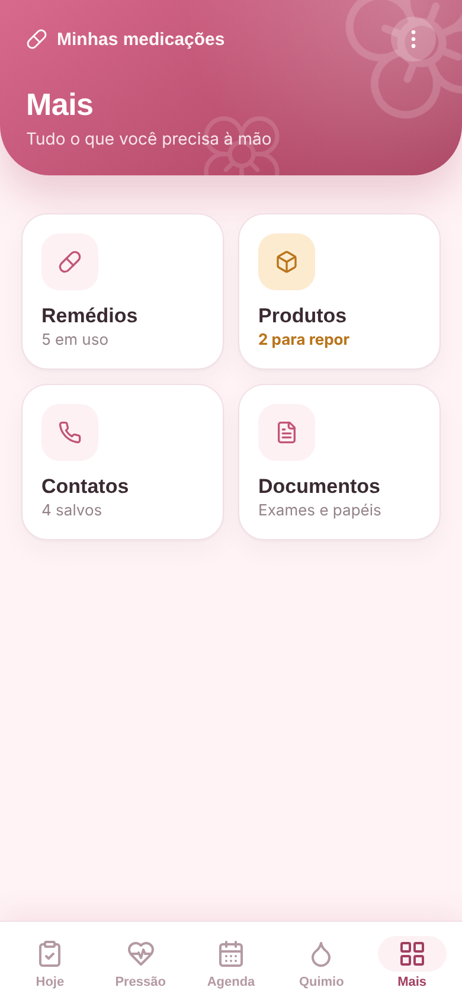
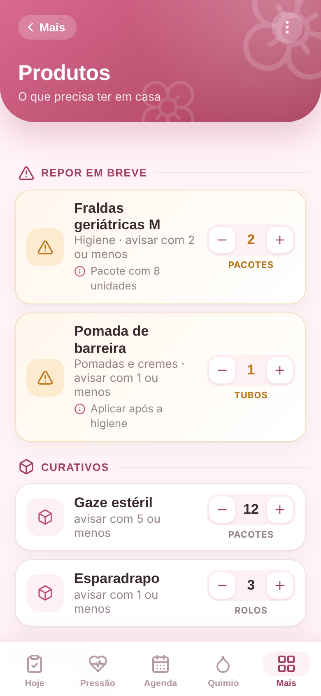
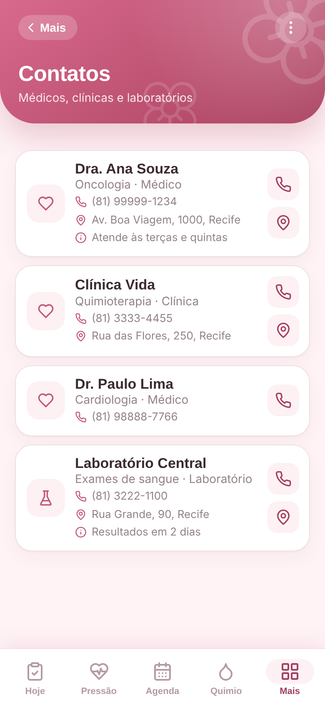
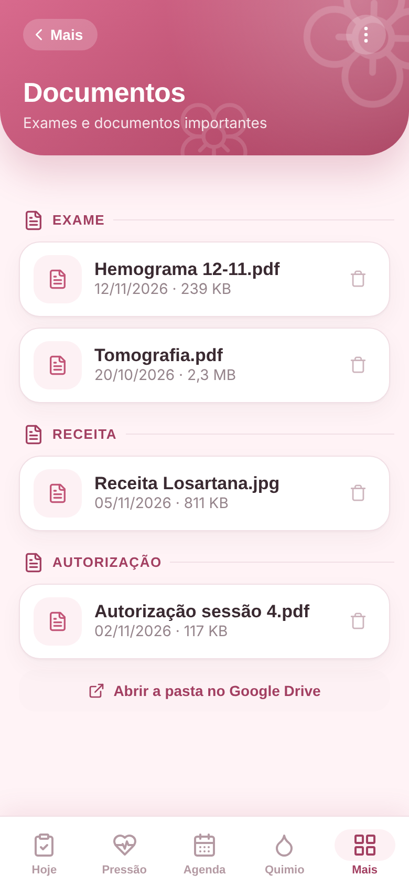

# 🌸 Minhas medicações

**Cuidar de quem a gente ama fica mais leve quando tudo está num só lugar.**

---

## 💗 Sobre o projeto

**Minhas medicações** é um aplicativo pessoal, criado para organizar o dia a dia de um tratamento de saúde: que remédio tomar e a que horas, as consultas e sessões, a pressão arterial, os contatos dos médicos, os exames guardados e as coisas que não podem faltar em casa.

Ele nasceu de uma necessidade real da família: são muitos horários, muitas datas para lembrar, autorizações para pedir com antecedência e remédios para comprar antes de acabarem. A ideia é simples: abrir o app, ver o que é para hoje e ficar tranquila.

---

## ✨ O que ele faz

O que mais se usa fica na barra de baixo. O resto está a um toque, em **Mais**.

| | |
|---|---|
| 📋 **Hoje** | As doses do dia, da manhã à noite. É só tocar para marcar o que já foi tomado e acompanhar o progresso. Os avisos importantes ficam logo no topo. |
| ❤️ **Pressão** | Um registro rápido da pressão arterial. Basta digitar os números: a data e a hora entram sozinhas, e o app mostra a evolução em um gráfico. |
| 📅 **Agenda** | Um calendário colorido com as sessões, os dias de cada remédio e as consultas, os **próximos compromissos** à vista e a lista dos últimos que já passaram. |
| 💧 **Quimio** | A área do tratamento: próxima sessão, número do ciclo, histórico de cada ciclo e a previsão do seguinte. |
| ⋯ **Mais** | **Remédios** (a ficha de cada um, com estoque), **Produtos** (fraldas, gazes, pomadas), **Contatos** (telefone e endereço de médicos e clínicas, com ligação e mapa em um toque) e **Documentos** (exames e papéis importantes, guardados no Google Drive). |

---

## 🌷 Pequenos cuidados que fazem diferença

- **Lembra das autorizações:** avisa quando é hora de pedir a autorização de uma sessão ou de um remédio.
- **Avisa a hora de comprar:** calcula quanto tempo o estoque de cada remédio dura e lembra de comprar antes de acabar.
- **Acompanha os ciclos:** cada sessão tem seu número, e o app sugere a data do próximo ciclo.
- **Respeita o tratamento:** os remédios do tratamento ficam destacados, e os que são tomados só em certos períodos aparecem apenas nesses dias.
- **Mais de uma dose por dia:** cada horário é marcado separadamente.
- **Visual delicado e fácil de usar:** pensado para o celular, com letras grandes e poucos toques.
- **Funciona como um app:** pode ser colocado na tela inicial do celular, em tela cheia.

---

## 📱 Um olhar por dentro

<table>
  <tr>
    <td align="center"> <b>Entrada protegida por PIN</b></td>
    <td align="center"> <b>Hoje</b></td>
    <td align="center"> <b>Agenda</b></td>
  </tr>
  <tr>
    <td align="center"> <b>Pressão</b></td>
    <td align="center"> <b>Mais</b></td>
    <td align="center"> <b>Remédios</b></td>
  </tr>
  <tr>
    <td align="center"> <b>Produtos</b></td>
    <td align="center"> <b>Contatos</b></td>
    <td align="center"> <b>Documentos</b></td>
  </tr>
</table>

Todas as imagens usam <b>dados fictícios</b>.

---

## 🔒 Privacidade

As informações ficam guardadas na própria conta Google de quem usa o app (na planilha e no Drive), e o acesso é protegido por um PIN. Nada é compartilhado com ninguém.

---

## 🛠️ Feito com

Google Planilhas, Google Drive, Google Apps Script e GitHub Pages. Quer entender como funciona ou montar uma versão sua? O passo a passo está em [COMO-INSTALAR.md](COMO-INSTALAR.md).

> ⚠️ Este app é um apoio de organização e **não substitui a orientação de médicos e outros profissionais de saúde**.

---

Feito com carinho 🌸

